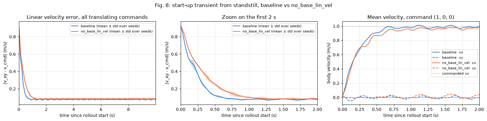
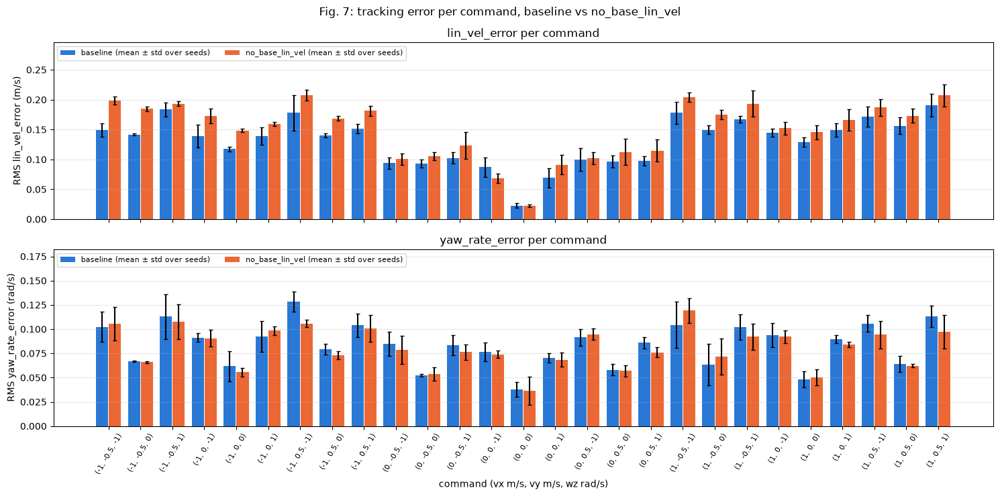

# Unitree Go2 locomotion with deep RL

Learning velocity-tracking locomotion for the Unitree Go2 quadruped with deep reinforcement learning (PPO, mjlab / MuJoCo Warp), on flat ground and on stairs. Solo project for the EPFL Legged Robots course, 2026.

## Demo

<!-- TODO: add the GIF files to media/ (see media/README.md) -->

| Stairs, climbing up | Stairs, walking down |
| --- | --- |
|  |  |

Final stairs policy on 20 cm steps, trained with observation noise and base centre of mass randomization.


Flat terrain baseline driven with the joystick: forward, lateral, turning, stop.

Full length videos are linked in [Demo videos](#demo-videos).

## Results

All numbers below come from the executed notebooks (`notebooks/02_flat_analysis.ipynb`), the run logs in `results/` and the stairs progress log in `doc/nb03_progress.md`. Values are mean ± std over seeds unless stated otherwise.

### Flat terrain baseline (3 seeds)

Evaluation: 27 commands (vx, vy, wz) x 10 robots, 10 s from standstill, seeds 42, 1 and 2.

| Metric | Value |
| --- | --- |
| Survival | 100 % (270/270 robots for each seed) |
| Linear velocity error (RMS, whole grid) | 0.131 ± 0.005 m/s |
| Yaw rate error (RMS, whole grid) | 0.084 ± 0.003 rad/s |
| Cost of transport, linear commands | 0.73 ± 0.04 |
| Cost of transport, linear + turn commands | 0.81 ± 0.05 |
| Mean mechanical power | 93 ± 6 W |
| Gait | trot with flight phases: diagonal pairs in the same contact state 78 % and 81 % of the time, front pair 19 % |
| Duty factor, stride frequency | 0.334 ± 0.009, 2.49 ± 0.05 Hz |
| Thigh torque, 99th percentile | 22.7 N m for a 23.5 N m limit (above 95 % of the limit during 1.18 % of the steps) |

Training converges early: the mean reward reaches 95 % of its final value at iteration 163 ± 12 of 500. The hardest commands combine translation and rotation (worst single command (1, 0.5, 1) with 0.191 m/s), standing still is tracked best (0.023 m/s). The thighs work close to saturation, which is the main deployability concern together with the missing sim-to-real measures (no randomization, no noise, no actuator model) of the flat policy.

### Controlled experiment: removing `base_lin_vel` from the actor (3 seeds per configuration)

The real Go2 has no sensor for the base linear velocity, it has to be estimated. The variant removes `base_lin_vel` from the actor observations (48 to 45 inputs). The critic keeps it, everything else (rewards, commands, PPO settings, 500 iterations, evaluation grid and seeds) is identical. A difference counts as real when the per-seed ranges of the two configurations do not overlap; the effect size is the difference divided by the largest seed range.

| Metric | Baseline | No `base_lin_vel` | Difference | Effect size | Ranges disjoint |
| --- | --- | --- | --- | --- | --- |
| Linear velocity error (eval) | 0.131 ± 0.005 m/s | 0.151 ± 0.007 m/s | +15 % | 1.5 | yes |
| `error_vel_xy` at the end of training | 0.197 ± 0.002 m/s | 0.240 ± 0.005 m/s | +22 % | 4.5 | yes |
| Linear error, first second | 0.255 ± 0.008 m/s | 0.34 ± 0.01 m/s | | | |
| Linear error, 5 to 10 s | 0.077 ± 0.005 m/s | 0.085 ± 0.008 m/s | | | |
| Settling time (error within 1.2 x steady state) | 0.69 ± 0.03 s | 1.02 ± 0.02 s | | | |
| Yaw rate error (eval) | 0.084 ± 0.003 rad/s | 0.081 ± 0.002 rad/s | -3 % | 0.4 | no |
| Survival | 100 % | 99.6 % (3 robots of seed 42 fell) | | 0.3 | no |
| Duty factor | 0.334 ± 0.009 | 0.336 ± 0.014 | +1 % | 0.1 | no |
| Stride frequency | 2.49 ± 0.05 Hz | 2.56 ± 0.09 Hz | +3 % | 0.4 | no |

The effect is real but small compared with the seed spread in evaluation (1.5 times the seed range), and it is concentrated in the start from standstill: the variant needs 1.02 s instead of 0.69 s to settle, and after 5 s the gap is small. During training, `error_vel_xy` covers 90 % of its decrease at iteration 150 ± 9 instead of 116 ± 3. The extra error appears only for translating commands, largest for backward ones (+0.050 m/s at (-1, -0.5, -1)). Yaw tracking, survival and the gait metrics do not change.

Mechanism: without `base_lin_vel` the actor is a memoryless MLP that has to infer its own velocity from the joint states, the last action and the IMU signals. While trotting the stride pattern carries this information, but during the acceleration from rest the same joint configuration can belong to different velocities and the policy cannot integrate accelerations, so it corrects later. The next test would be a proprioceptive history or a learned velocity estimator.

<!-- TODO: export Fig. 8 and Fig. 7 from notebooks/02_flat_analysis.ipynb to media/ -->



Linear velocity error over time since the start of the rollout, baseline vs variant (NB02, Fig. 8).



Tracking error per command, baseline vs variant (NB02, Fig. 7).

### Stairs (20 cm steps)

Pyramid and inverted pyramid stairs, step height from 0 to 20 cm over 10 curriculum rows, forward commands of 0.5 to 1.0 m/s, one seed per configuration. Run 1 adds only the terrain height scan to the flat MDP (with relaxed vertical velocity and orientation penalties); run 2 adds observation noise on the actor and a randomized base centre of mass. Values at iteration 499.

| | Run 1 (scan only) | Run 2 (scan + noise + CoM randomization) |
| --- | --- | --- |
| Mean terrain level | 5.89 | 5.99 |
| Level, stairs up | 5.93 | 5.98 |
| Level, stairs down | 5.85 | 6.00 |
| Falls per episode | about 1.6 % | about 1.8 % |
| Episode length (ends at the tile edge) | 418 steps (8.4 s) | 429 steps (8.6 s) |
| Linear tracking reward per second (max 1.0) | 0.92 | 0.89 |
| Yaw tracking reward per second (max 0.5) | 0.44 | 0.42 |

The curriculum is saturated for both runs, up and down: a robot promoted past the last row goes back to a random row, so a policy that succeeds everywhere settles around a mean level of 6, not 9. In the viewer with 20 cm steps on every row, run 1 climbs and descends without a fall over repeated crossings, and the final policy (run 2) is the one shown in the demo above. Noise and centre of mass randomization cost almost nothing here (same levels, same fall rate, tracking 3 % lower). Their benefit, robustness to sensor errors and to a shifted payload for sim-to-real transfer, cannot be measured without the real robot, since the evaluation uses the same simulator. Run 2 is kept as the final policy because it is the more deployable one for the same performance.

## Method in brief

The environment and the training setup are written in the notebooks (`make_commands`, `make_observations`, `make_actions`, `make_rewards`, `make_terminations`, `make_events`).

- Commands: on flat ground vx in [-1, 1] m/s, vy in [-0.5, 0.5] m/s, wz in [-1, 1] rad/s, resampled every 10 s, 10 % standing and 10 % forward-only robots. On stairs, forward only, 0.5 to 1.0 m/s, one command per episode.
- Actor observations: command, base linear and angular velocity, projected gravity, joint positions and velocities, last action. On stairs, plus a terrain height scan (54 rays).
- Critic observations: the actor terms without noise, plus foot contacts and foot air time (asymmetric actor-critic: privileged information used only during training).
- Actions: joint position targets for the 12 joints, offset from the default standing pose, scale 0.25 rad, tracked by PD controllers.
- Rewards: linear velocity tracking (weight 1.0) and yaw rate tracking (0.5) as the task; penalties on vertical velocity, roll and pitch rate, base orientation, joint torques, joint acceleration, action rate and leg contacts; a feet air time term against shuffling. The structure follows Rudin et al. (2022). On stairs the vertical velocity and orientation penalties are relaxed (-2.0 to -0.5 and -1.0 to -0.2), since climbing needs vertical motion and a pitched base.
- Terminations: 20 s time-out, base contact, tilt above 1 rad. On stairs, reaching the tile edge is treated as a time-out (a success).
- Observation noise (stairs, actor only): uniform noise on velocities, gravity, joint states and the height scan (0.05 m), none on the command and the last action.
- Domain randomization (stairs): base centre of mass offset sampled at startup, x ±5 cm, y ±3 cm, z ±3 cm, like a fixed payload. Larger x shifts would overload thighs already near their torque limit.
- Terrain curriculum (stairs): robots are promoted to steeper rows when they walk far enough and demoted when they cover less than half the commanded distance.
- Training: PPO from rsl_rl, actor and critic MLPs 128x128x128, 4096 parallel robots, 500 iterations. Flat configurations are trained with seeds 42, 1 and 2; each stairs configuration with seed 42.

These choices follow the course material on MDP design and sim-to-real (lecture 4, G. Bellegarda; lecture 5, M. Hutter): asymmetric actor-critic, observation noise, domain randomization, curriculum and exteroception. Actuator models and proprioceptive history are not used.

## Repository structure

```
notebooks/
  00_setup_check.ipynb     GPU, simulator and viewer check
  01_flat_terrain.ipynb    flat MDP, baseline training (3 seeds), ablation variant, rollouts
  02_flat_analysis.ipynb   analysis of the baseline and of the controlled experiment (CPU only)
  03_stairs.ipynb          stairs MDP, height scan, noise, CoM randomization, curriculum
src/lr_project/
  metrics.py               evaluation metrics (tracking, CoT, GRF, gait, stability)
  ...                      starter code: MDP building blocks, scene, training, evaluation, viewer
scripts/summarize_runs.py  builds the run log from the TensorBoard files
results/                   run log, one CSV row per training run (logs/ is not versioned)
doc/
  roadmap.md               work plan and course methods applied
  nb03_progress.md         stairs decisions, runs and observations
  assignment.md            original course assignment (setup, submission rules)
media/                     GIFs and figures shown in this README
```

## Reproduce

Setup (gnoto server or a Linux machine with an NVIDIA GPU) is described in [doc/assignment.md](doc/assignment.md): `bash gnoto.sh` on gnoto or `uv sync` locally, then the `LR Project Kernel`.

1. `notebooks/01_flat_terrain.ipynb`: run sections 1.1 and 1.2, then the seed repeats in 1.3b (seeds 42, 1, 2), the `command_grid` rollouts in 1.4b, the variant training in 1.5d and its rollouts in 1.5f.
2. `notebooks/02_flat_analysis.ipynb`: runs on CPU, reads `logs/flat/`.
3. `notebooks/03_stairs.ipynb`: set `USE_NOISE` and `USE_DR` in the "Run configuration" cell, run 3.1 to 3.3 for training, then the demo viewer cell (`DEMO_DIRECTION`, `DEMO_STEP_HEIGHT`).
4. After each training run: `python scripts/summarize_runs.py` (flat) or `python scripts/summarize_runs.py stairs`, see `results/README.md`.

`logs/` (checkpoints, TensorBoard files, evaluation rollouts) is not versioned, so the notebooks have to be re-run to get the trained policies.

## Demo videos

<!-- TODO: paste the GitHub user-attachments video links below -->

- Flat baseline, joystick: TODO
- Stairs, climbing up: TODO
- Stairs, walking down: TODO

## Credits and license

- Starter code and assignment by Louis Gevers (EPFL BioRob, Legged Robots course), released under the BSD-3-Clause license, see [LICENSE](LICENSE).
- Built on [mjlab](https://github.com/mujocolab/mjlab) (MuJoCo Warp) and [rsl_rl](https://github.com/leggedrobotics/rsl_rl).
- Reward and observation design inspired by N. Rudin, D. Hoeller, P. Reist and M. Hutter, "Learning to Walk in Minutes Using Massively Parallel Deep Reinforcement Learning", CoRL 2022.

My own work: the MDP design in the notebooks (commands, observations, actions, rewards, terminations, events, noise, randomization and curriculum settings), the controlled experiment, the metrics in `src/lr_project/metrics.py`, the analysis in `02_flat_analysis.ipynb`, and the run log tooling (`scripts/summarize_runs.py`, `results/`).
